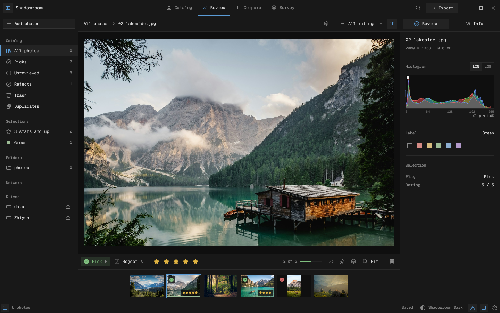
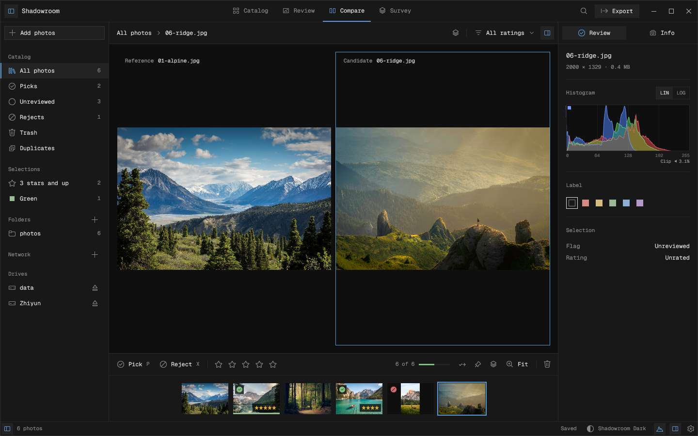
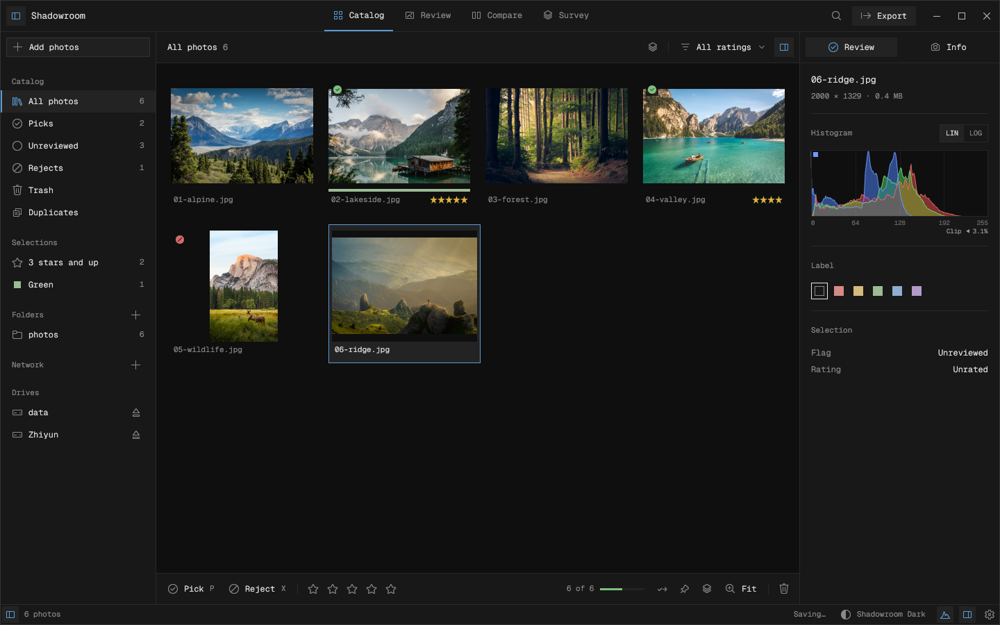
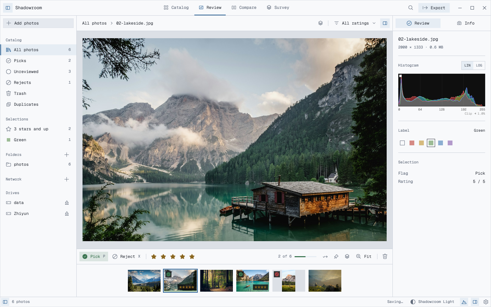

# Shadowroom

**Find the photographs worth keeping. Leave the originals untouched.**

A native photo culling workspace for Linux and macOS, built in Rust with
[GPUI](https://www.gpui.rs/). Review a shoot, compare frames, flag picks, and carry
your decisions into the next editor.



**Early release · 0.1.0 · Apache-2.0**

[Get started](#get-started) · [Performance](#performance) · [Documentation](docs/README.md) · [Contributing](CONTRIBUTING.md)

## A workspace for the first pass

- **Review at your pace.** Grid, loupe, pinned comparison, and Survey views;
  keyboard decisions, optional automatic advance, stars, and color labels.
- **Keep a shoot together.** Pair RAW+JPEG/HEIF companions and group nearby frames
  by time or visual similarity. Burst grouping refines as previews arrive.
- **Import with a plan.** Preview names and folders, copy to a library and backup
  destinations, verify copies, and resume interrupted work.
- **Protect the originals.** Decisions live in a local SQLite catalog. Trash is
  restorable inside the app; exact-duplicate scans return matches for review.
- **Take your decisions onward.** Copy picks with their companions or export XMP
  sidecars to a separate destination. Existing destination files are preserved.
- **Make it yours.** Resizable sidebars, three bundled fonts, light/dark themes,
  and Zed theme imports. Explore preferences, then Apply or Cancel your changes.
  Control the desktop through MCP or review remote sources with the SSH agent.

<table>
  <tr>
    <td></td>
    <td></td>
  </tr>
  <tr>
    <td><strong>Compare</strong> — keep a reference beside the next candidate.</td>
    <td><strong>Catalog</strong> — see the shoot and its decisions together.</td>
  </tr>
</table>

<details>
<summary>See the light theme</summary>



</details>

## Get started

[Download v0.1.0](https://github.com/aaditagrawal/shadowroom/releases/tag/v0.1.0)
for the Linux x86_64 archive and source release. The Linux binary is a Fedora 45
build and requires compatible system libraries; macOS users can build from source.

Install a current stable Rust toolchain and the
[native prerequisites for your platform](docs/BUILD.md), then build both binaries:

```sh
LCMS2_STATIC=1 cargo build --locked --release --bins
./target/release/shadowroom /path/to/photos
```

On macOS, the default build needs Xcode's Metal tools. Command Line Tools users
can add `--features runtime-shaders`. Linux needs a desktop session and Vulkan
drivers. Native package and AppImage instructions are in the [build guide](docs/BUILD.md).

Open a folder with **Cmd/Ctrl+O** or **Add photos** to plan a copy import. Passing a
folder on the command line indexes it in place. Pick or rate frames as you review,
then use **Export** to copy picks. Export XMP sidecars and other commands are in
the command palette (**Cmd/Ctrl+K**).

| Key | Action |
| --- | --- |
| `←` / `→` | Previous / next photograph |
| `P` / `X` / `U` | Pick / reject / clear flag |
| `0`–`5` | Star rating; zero clears |
| `6` / `7` / `8` / `9` | Red / yellow / green / blue label |
| `G` / `L` / `C` | Grid / loupe / compare |
| `B` | Pin comparison reference |
| Space or `Z` | Fit / 100% |
| Shift+`↓` / Shift+`↑` | Extend / shrink selection by a grid row |
| `[` / `]` | Previous / next group |
| Cmd/Ctrl+Z | Undo decision |

See [keyboard and Creator Micro controls](docs/CONTROLS.md) for the complete
controller mapping and calibration guide. Physical controller validation remains
a hardware test.

## Performance

Measured on an **Intel Core i5-10300H, Fedora Linux 45, native X11/Xwayland**, using
the optimized release build. Three independent runs each indexed **10,000
synthetic photo paths** into a fresh catalog.

<!-- measured-results:start -->
| Measurement | Result |
| --- | ---: |
| Index 10,000 synthetic paths, median | 0.278 s |
| Photo selection, median / p95 | 0.58 / 6.41 ms |
| Star-rating acceptance, median / p95 | 0.22 / 1.97 ms |
| Peak process RSS across all three runs | 204 MiB |
<!-- measured-results:end -->

The fixture uses 16 hardlinked 128×80 BMPs with warm OS page caches. Command
timings include MCP transport; a rating response accepts the edit before its
durable save. These measurements cover catalog/command behavior, not RAW decode,
camera-card throughput, or frame presentation. [Methodology, raw samples, and reproduction commands](docs/PERFORMANCE.md) are included.

## Formats and limits

| Media | Display path |
| --- | --- |
| JPEG, PNG, WebP, BMP | Native preview pipeline |
| TIFF / BigTIFF | First page; supported integer/float samples and ICC conversion |
| JPEG XL | Integer SDR, including 8/16-bit input and straight alpha; first animation frame |
| HEIC / HEIF / HIF | ImageIO on macOS; libheif with a compatible decoder on Linux |
| Camera RAW | Paired or embedded preview for Fit; LibRaw sensor rendering for 100% |

RAW camera/variant support depends on LibRaw. A 24 MP sensor render can exceed the
default 512 MiB media budget; raise it to 2 GiB in Preferences when needed. That
budget covers admitted media work, not total process RSS.

Display output is **8-bit sRGB**. HDR/wide-gamut output, soft proofing, lens
corrections, video playback, and AVIF are outside this release. See
[media and color behavior](docs/MEDIA.md) for exact format restrictions.

## Your catalog, your files

Catalog, settings, and caches use the operating system's local application-data
directories. A disconnected drive does not remove its catalog entries; cached
previews can remain available offline. The footer distinguishes pending, failed,
and saved changes. Normal quit waits for saves and accepted exports; failed writes
remain visible for retry. See [recovery and durability](docs/RECOVERY.md).

Review decisions never edit or delete source photographs. Copy imports and exports
write to explicitly selected destinations. XMP export is an explicit interchange
step; it does not automatically synchronize with another editor. Back up the
local catalog to preserve decisions independently of your image backups.

## Documentation and development

[Import](docs/INGEST.md) · [Export](docs/EXPORT.md) · [Themes](docs/THEMES.md) ·
[Remote access](docs/NETWORK.md) · [MCP](docs/MCP.md) · [All guides](docs/README.md)

```sh
cargo test --locked --no-default-features
cargo test --locked --bin shadowroom
cargo fmt --all -- --check
```

[CI](.github/workflows/ci.yml) checks core/integration behavior and builds native
Linux/macOS packages. [Contributing](CONTRIBUTING.md) covers local checks;
[releasing](docs/RELEASING.md) covers packaging and platform validation. Windows
packages are not provided. macOS distribution signing/notarization is separate
from the default ad-hoc package signature.

## License and credits

Shadowroom is licensed under [Apache-2.0](LICENSE). Bundled fonts, Codicons, and
dependencies retain their own licenses; see [third-party notices](THIRD_PARTY_NOTICES.md).
Screenshots show the native application with demo photographs from Unsplash.
[Image credits and provenance](docs/images/README.md).
